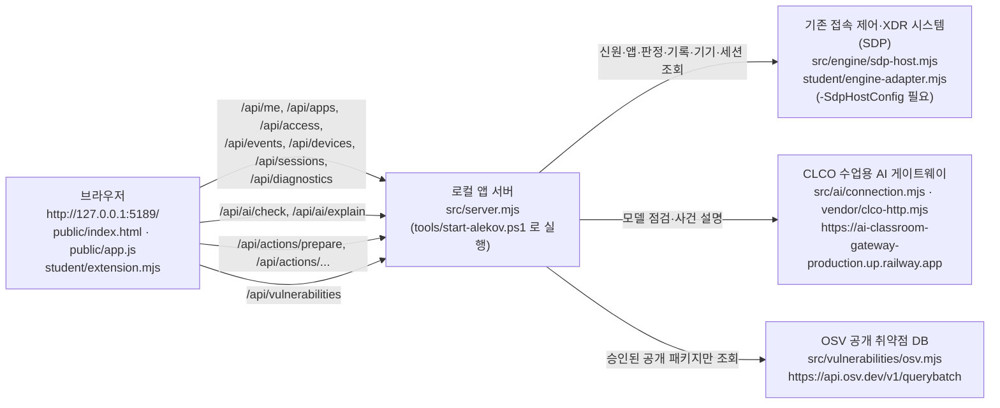

# 케셰브 학생 실행 설명서와 시스템 구성도 (21단계)

이 문서는 학생이 새로 작성한 문서입니다. 제공 문서(`README.md`, `docs/` 아래 기존 파일)는 고치지 않았습니다.
`README.md`는 `.on-starter-manifest.json`에 해시가 등록된 제공 파일이고 학생 부분이 따로 없어서, 목적·기능·구성·지원 환경과 버전도 이 문서에 적습니다.

표기 약속

- **실제 화면 확인**: 내 PC에서 앱을 켜고 브라우저 화면이나 PowerShell 출력으로 직접 본 것
- **예제 자료 확인**: `-Demo`(예제 데이터) 모드에서 본 것. 실제 연결 성공이 아닙니다.
- **코드만 읽음**: 소스 코드를 읽어 확인했지만 실행해 보지 않은 것
- **미확인(UNV)**: 실행하지 않았거나 결과를 받지 못한 것

확인 날짜: 2026-11-23 (한국 시각 기준 오전)

---

## 1. 목적과 기능

케셰브(KESHEV)는 회사 직원이 **자기 로그인 상태, 업무 앱 접속 판정, 접속·XDR 보안 기록, 기기·세션 상태, AI 사건 설명, 설치 패키지 취약점 조회 결과**를 한 화면에서 보는 ZTNA·XDR 보안 Agent 앱입니다.
화면 맨 위 제목은 「케셰브 ZTNA & XDR 보안 Agent」이고, 왼쪽 메뉴는 「보호 현황」「업무 앱」「보안 기록」 세 개입니다. (실제 화면 확인)

## 2. 지원 환경과 버전

| 항목 | 값 | 근거 | 확인 |
|---|---|---|---|
| 운영체제 | Windows 11 Pro (10.0.26200) | 내 PC | 실제 확인 |
| PowerShell | Windows PowerShell 5.1 (5.1.26100) | `$PSVersionTable` 출력 | 실제 확인 |
| Node.js 수업 기준 | 24.19.0 | `package.json`의 `engines.node`, `tools/start-alekov.ps1` | 코드만 읽음 |
| Node.js 실행 허용 범위 | 22~24 | `tools/start-alekov.ps1`의 버전 검사 | 코드만 읽음 |
| 내 PC의 Node.js | v24.21.0 | `node --version` 출력. 실행 도구가 「참고: 지금 Node.js 는 v24.21.0 입니다. 수업 기준은 v24.19.0 입니다.」를 표시하고 계속 실행함 | 실제 확인 |
| 시작 틀 버전 | `alekov-client-starter` 0.2.21 | `package.json` | 코드만 읽음 |
| 외부 npm 의존성 | 없음 (`npm install` 필요 없음, `package-lock.json` 없음) | `package.json`에 `dependencies` 없음 | 코드만 읽음 |
| 브라우저 | 앱 안 브라우저(Chromium 계열)에서 확인 | 실제 화면 | 실제 확인. 다른 브라우저는 미확인 |

지원하지 않거나 확인하지 않은 환경: macOS·Linux, Node.js 21 이하·25 이상(실행 도구가 멈춤), 설치형 전체 앱(바탕화면 바로가기로만 켬, 이 문서 범위 밖)은 확인하지 않았습니다.

## 3. 폴더 구조 (학생이 알아야 할 부분만)

```
케셰브-방어전\
└─ on-client\                 ← Git 최상위 폴더. PowerShell은 여기서 엽니다.
   ├─ package.json            제공. 실행 스크립트(start, demo, check)
   ├─ .env.example            제공. 비밀 없는 설정 견본 (.env는 없음, 10번 항목 참고)
   ├─ .on-starter-manifest.json  제공. 제공 파일 목록과 해시
   ├─ tools\start-alekov.ps1  제공. 앱 실행 도구
   ├─ src\server.mjs          제공. 로컬 앱 서버(127.0.0.1:5189)
   ├─ src\engine\             제공. 기존 접속·XDR(SDP) 연결
   ├─ src\ai\                 제공. AI 게이트웨이 연결
   ├─ src\vulnerabilities\    제공. OSV 취약점 조회
   ├─ vendor\clco-http.mjs    제공. CLCO 수업용 AI 호출 도구
   ├─ public\index.html, app.js  제공. 공통 화면
   ├─ student\extension.mjs   학생 작성. 13~20단계 화면 표시 함수
   ├─ student\engine-adapter.mjs 제공 틀. 기존 서버 연결 어댑터(이번 과제에서 수정 안 함)
   └─ docs\STUDENT_RUNBOOK.md 학생 작성. 이 문서
```

내 PC에서 확인한 실제 위치: `C:\Users\User\AppData\Local\ALEPH\Workbench\projects\케셰브-방어전\on-client`

## 4. 설치·실행 순서

아래 명령은 모두 2026-11-23에 내 PC의 PowerShell에서 실제로 실행해 결과를 확인한 것입니다. 따로 적은 것만 미확인입니다.

### 4-1. PowerShell 여는 위치

1. 파일 탐색기에서 `on-client` 폴더를 엽니다.
2. 주소창에 `powershell`을 입력하고 Enter를 누르면 그 폴더에서 PowerShell이 열립니다.
   또는 새 PowerShell 창에서 아래처럼 이동합니다.

```powershell
cd "C:\Users\User\AppData\Local\ALEPH\Workbench\projects\케셰브-방어전\on-client"
```

위 경로는 내 PC의 예시입니다. 다른 PC에서는 저장소를 받은 폴더로 이동합니다.
주의: Git 폴더를 사용자 폴더 바로 아래(`C:\Users\<이름>\<저장소>`)에 두면 실행 도구가 `ALEKOV_NATIVE_PREPARE_NESTED`로 멈춥니다. `C:\Users\<이름>\<프로젝트 폴더>\on-client`처럼 한 단계 안에 받습니다. (22단계 새 폴더 재현에서 실제 확인)

### 4-2. 필요 프로그램 확인

```powershell
node --version
```

`v22`~`v24`로 시작하면 됩니다. 없으면 실행 도구가 「Node.js 가 없습니다. https://nodejs.org 에서 Node.js 24.19.0(LTS)을 설치한 뒤 새 PowerShell 창에서 다시 실행해 주세요.」를 표시합니다(이 문구는 코드만 읽음).
추가 설치(`npm install`)는 필요 없습니다.

### 4-3. 앱 켜기 (기본 모드)

```powershell
powershell -NoProfile -ExecutionPolicy Bypass -File .\tools\start-alekov.ps1
```

`-ExecutionPolicy Bypass`는 이 한 번의 실행에만 적용되고 컴퓨터 설정을 바꾸지 않습니다.

**정상 시작 신호** (실제 확인한 출력)

```
계정 연결 준비가 끝났습니다. 앱에서 확인 번호로 로그인·승인을 진행하세요.
케셰브가 켜졌습니다. 브라우저에서 http://127.0.0.1:5189/ 을 여세요.
서버가 응답한 것만 확인했습니다. AI 연결 상태는 화면에서 따로 확인해 주세요.
끄려면 이 창에서 Ctrl+C 를 누르세요.
```

- 「케셰브가 켜졌습니다」는 **서버가 응답했다는 뜻만** 있습니다. AI 연결이나 기존 서버 연결 성공이 아닙니다.
- 마지막 줄 「끄려면 이 창에서 Ctrl+C 를 누르세요.」는 앞에서 켤 때 나옵니다. 저는 `-Background`로 확인해서 이 줄 대신 「뒤에서 실행 중입니다(프로세스 번호 …)」가 나왔습니다.

### 4-4. 브라우저 주소

`http://127.0.0.1:5189/` 를 엽니다. (실제 화면 확인)

기본 모드에서 실제로 본 화면

- 맨 위 상태 표시(`#mode-badge`, `data-mode="disconnected"`): 「연결 없음」
- 오류 안내: 「기존 서버·에이전트의 연결을 확인할 수 없습니다. 연결 어댑터를 먼저 확인하세요.」
- 이것은 개인 SDP 설정(`-SdpHostConfig`) 없이 켰기 때문이며, 고장이 아닙니다.

### 4-5. 예제 데이터로 켜기

```powershell
powershell -NoProfile -ExecutionPolicy Bypass -File .\tools\start-alekov.ps1 -Demo
```

실제로 본 화면: 상태 표시 「예제 데이터(demo) · 실제 연결 아님」, 사용자 「연습 사용자 (ID: practice-user)」. **예제 자료이며 실제 연결 성공이 아닙니다.**

### 4-6. 그 밖의 옵션

| 명령 | 하는 일 | 확인 |
|---|---|---|
| `...start-alekov.ps1 -Background` | 창 없이 뒤에서 실행, 프로세스 번호 표시 | 실제 확인 |
| `...start-alekov.ps1 -Port 5190` | 5189 대신 다른 포트 | 실제 확인 (22단계 새 폴더 재현, `docs/STUDENT_RELEASE_RECORD.md`) |
| `npm run check` | `student/extension.mjs` 문법만 검사 (`node --check`) | 실제 확인. 종료 코드 0 |
| `npm start` | `node src/server.mjs` 실행 | 미확인 (실행 안 함) |
| `npm run demo` | `node src/server.mjs --demo` 실행 | 미확인 (실행 안 함) |

### 4-7. 끄기와 다시 켜기

1. 앞에서 켰다면: 실행한 PowerShell 창에서 `Ctrl+C`를 누릅니다. (2026-11-23 새 PowerShell 창에서 4-3 명령으로 켠 뒤 `Ctrl+C`로 끄는 것까지 사용자가 직접 확인)
2. `-Background`로 켰다면: 표시된 프로세스 번호의 node를 작업 관리자에서 종료합니다. 저는 PowerShell에서 아래처럼 껐고, 5189 포트가 비는 것을 확인했습니다. (실제 확인)

```powershell
Stop-Process -Id <표시된 프로세스 번호>
```

3. 다시 켜려면 4-3의 명령을 다시 실행합니다. 기본 모드를 끈 뒤 `-Demo`로 다시 켜서 화면이 예제 자료로 바뀌는 것을 확인했습니다. (실제 확인)
4. 포트가 이미 쓰이고 있으면 실행 도구가 다른 프로그램을 끄지 않고 「포트 5189 를 다른 프로그램이 쓰고 있습니다. … 예: -Port 5190」을 안내합니다. (코드만 읽음)

---

## 5. 시스템 구성도

### 5-1. Mermaid



### 5-2. 같은 내용을 글(ASCII)로

```
[브라우저 http://127.0.0.1:5189/]
   public/index.html, public/app.js (제공 화면)
   student/extension.mjs (학생 표시 함수)
        │  HTTP (같은 PC 안, 127.0.0.1)
        ▼
[로컬 앱 서버  src/server.mjs]  ← tools/start-alekov.ps1 이 실행
        │
        ├──▶ [기존 접속 제어·XDR 시스템(SDP)]  src/engine/sdp-host.mjs, student/engine-adapter.mjs
        │       기본 실행에서는 연결 없음(ENGINE_NOT_CONNECTED). -SdpHostConfig 로 개인 설정을 줄 때만 연결
        │
        ├──▶ [CLCO 수업용 AI 게이트웨이]  src/ai/connection.mjs, vendor/clco-http.mjs
        │       https://ai-classroom-gateway-production.up.railway.app
        │       연결 정보는 앱 서버가 따로 보관. 브라우저에는 열쇠가 오지 않음
        │
        └──▶ [OSV 취약점 DB]  src/vulnerabilities/osv.mjs, https://api.osv.dev/v1/querybatch
                승인된 공개 패키지 목록이 비어 있으면 외부 조회하지 않음
```

### 5-3. 상자별 확인 결과

| 상자 | 파일·주소 | 확인 |
|---|---|---|
| 브라우저 | `http://127.0.0.1:5189/` | 실제 확인. 화면이 뜨고 학생 표시 칸 8곳이 보임 |
| 로컬 앱 서버 | `src/server.mjs` | 실제 확인. 실행 도구가 200 응답을 받음, `/api/diagnostics` 결과 표시됨 |
| 기존 접속·XDR 시스템 | `src/engine/sdp-host.mjs`, `student/engine-adapter.mjs` | **미확인**. 기본 실행에서 「연결 없음」(`engine.code: ENGINE_NOT_CONNECTED`)만 확인. 개인 SDP 설정이 없어 실제 연결은 안 해 봄 |
| CLCO 수업용 AI 게이트웨이 | `src/ai/connection.mjs`, 위 주소 | **미확인**. 이번 확인에서 「AI 연결 점검」을 누르지 않음. 이전 단계 기록상 실제 호출은 `ON_AI_PROVISIONING_PENDING`로 실패 |
| OSV 취약점 DB | `src/vulnerabilities/osv.mjs`, 위 주소 | **미확인**. 「설치 패키지 조회」를 누르지 않음 |

---

## 6. 제공 코드와 학생 작성 부분의 구분

기준: `.on-starter-manifest.json`의 `sourceHashes` 목록에 있는 파일은 제공 파일입니다.

| 구분 | 파일 | 내용 |
|---|---|---|
| 제공 | `public/index.html`, `public/app.js`, `public/*.mjs`, `public/style.css` | 공통 화면, 메뉴, 버튼, API 호출. 화면에 「제공」이라고 표시된 칸 |
| 제공 | `src/` 전체, `vendor/`, `tools/` | 앱 서버, SDP·AI·OSV 연결, 실행 도구 |
| 제공 | `README.md`, `docs/`의 기존 문서, `package.json`, `.env.example` | 안내·설정 견본 |
| 제공 틀(이번 단계 수정 안 함) | `student/engine-adapter.mjs` | 기존 서버 연결 어댑터 |
| **학생 작성** | `student/extension.mjs` | 13~20단계 표시 함수 8개. 화면에 「학생 구현 표시 · student/extension.mjs · 함수 이름」으로 표시된 칸 |
| **학생 작성** | `docs/STUDENT_RUNBOOK.md` | 이 문서 (21단계) |

화면 맨 위에도 「제공 공통 UI와 학생 구현 표시(student/extension.mjs)는 구분되어 있습니다.」라고 나옵니다. (실제 화면 확인)

### 6-1. 내가 구현한 함수 (`student/extension.mjs`의 `createStudentView()`)

모든 함수는 `document.createElement`와 `textContent`로 화면을 만들고, 색이 아니라 글자로 상태를 구분합니다.

| 단계 | 함수 | 화면 위치 | 보여 주는 것 |
|---|---|---|---|
| 13 | `renderIdentity` | 보호 현황 › 현재 로그인 | 로그인 사용자·현재 기기·현재 세션. 연결 실패면 「연결 실패」, 응답 형식이 맞지 않으면 「확인 불가」로 표시하고 사용자 정보를 숨김 |
| 14 | `renderDecision` | 업무 앱 › 판정 결과 | 허용(allow)·거부(deny)·추가 확인 필요(challenge)·확인 불가(unknown)와 판정 이유·시각. unknown·요청 실패는 「허용되지 않음」으로 표시 |
| 15 | `renderEvents` | 보안 기록 › 접속·XDR 기록 | 접속 기록(access)·XDR 경보(xdr) 목록, 시각(한국 시각 함께), 필터(기록 종류·업무 앱·접속 상태), 상세(근거·규칙·상태). 기록 없음과 조회 실패를 구분 |
| 16 | `renderStatus` | 보호 현황 › 학생 상태·알림 표시 | 등록 기기·현재 세션·알림·도움정보. 불러오는 중·없음·시간 초과·오류를 구분하고, 도움정보 6개 값만 복사하는 「도움정보 복사」 버튼 제공 |
| 17 | `renderAiConnection` | 보호 현황 › 학생 AI 연결 표시 | AI 연결 점검 전·중·실패·결과. 오류 코드를 원인 묶음(권한 준비 중·확인 불가, 인증 실패 등)으로 안내. 모델 수 응답은 사건 설명 성공이 아님을 표시 |
| 18 | `renderExplanation` | 보안 기록 › 학생 AI 사건 설명 | AI 요약·인용한 근거·규칙·확인할 수 없는 상태·조치 제안(미실행). 근거 ID가 기록에 없거나 「이미 실행했다」고 답한 설명은 쓰지 않음 |
| 19 | `renderAction` | 보안 기록 › 학생 조치 상태 표시 | 조치 상태(idle·prepared·executing·pending·succeeded·denied·failed·unknown·expired·error). 접수 응답(ACK)과 효과 관측을 구분 |
| 20 | `renderVulnerabilities` | 보호 현황 › 학생 패키지 조회 표시 | 설치 패키지별 정확한 버전·OSV 조회 상태·취약점 ID·출처·시각. 일부 실패(partial)·미조회(not_checked)·확인 불가를 「취약점 없음」과 구분 |

---

## 7. 장애 안내 (화면 문구 → 원인 → 확인 순서 → 복구)

화면 문구는 실제 코드(`student/extension.mjs`, 제공 화면)에 있는 문구입니다. 실제 화면에서 본 것만 「실제 확인」으로 적었습니다.

| 화면 문구 | 원인(오류 코드) | 확인 순서 | 복구 방법 | 확인 |
|---|---|---|---|---|
| 상태 표시 「연결 없음」, 「기존 서버·에이전트의 연결을 확인할 수 없습니다. 연결 어댑터를 먼저 확인하세요.」 | 기존 SDP 서버에 연결하지 않음 (`ENGINE_NOT_CONNECTED`) | 1) 「도움정보 불러오기」를 누름 2) `engine.mode: disconnected`, `engine.code: ENGINE_NOT_CONNECTED`인지 봄 3) 실행 명령에 `-SdpHostConfig`를 넣었는지 봄 | 담당자가 개인 SDP 설정을 발급한 뒤 그 설정으로 다시 실행. 설정이 없으면 화면 작업은 `-Demo`로 확인 | 실제 확인 |
| 「로그인 정보: 확인 불가: …」 | 응답 형식 불일치 (`CONTRACT_MISMATCH`, `ENGINE_RESULT_UNVERIFIED`) | 1) 「다시 불러오기」 한 번 2) 계속되면 도움정보를 담당자에게 | 원인 확인 뒤 다시 불러오기 | 코드만 읽음 |
| 「판정: 확인 불가(unknown) · 허용되지 않음」 | 서버가 판정을 확인하지 못함 | 판정 이유·시각 확인 | 접근은 허용되지 않은 것으로 처리. 다시 요청은 직접 | 코드만 읽음 |
| 「기록을 불러오지 못했습니다: …」, 「조회에 실패했으므로 기록 목록을 표시하지 않습니다. 기록이 없다는 뜻이 아닙니다.」 | 보안 기록 조회 실패 | 위 「연결 없음」과 같은 순서 | 연결을 고친 뒤 「다시 불러오기」 | 실제 확인 |
| 「표시할 기록이 없습니다.」 | 정상 응답 0건 | 실패가 아님 | 없음 | 코드만 읽음 |
| 「… 불러오지 못했습니다(시간 초과, 코드): …」 | 기기·세션 요청 시간 초과 | 네트워크·서버 상태 | 「다시 불러오기」를 직접 누름. 자동 재시도 없음 | 코드만 읽음 |
| 「AI 연결 점검 실패: 권한 준비 중·확인 불가」 | `ON_AI_PROVISIONING_PENDING`, `ON_AI_TRANSPORT_PENDING`, `ON_AI_AUTHORIZATION_CHANGED` 등 | 오류 코드 줄 확인 | 학생 코드 문제가 아님. 담당자에게 계정 연결과 앱 권한 확인 요청 | 이전 단계 기록(이번 미확인) |
| 「AI 연결 점검 실패: 인증 실패」 | `WB_CLCO_AUTH_REQUIRED` | 계정 연결 상태 | 「계정 연결 시작」부터 다시. 계속되면 담당자에게 | 코드만 읽음 |
| 「AI 연결 점검 실패: 접근 제한」 | `WB_CLCO_ACCESS_BLOCKED` | 이용 권한·운영 중지 여부 | 담당자에게 확인 | 코드만 읽음 |
| 「AI 연결 점검 실패: 반 사용량·이용 한도 초과」 | `WB_CLCO_COHORT_BUDGET_EXHAUSTED`, `WB_CLCO_LIMIT_REACHED` | 없음 | 담당자에게 확인 | 코드만 읽음 |
| 「AI 연결 점검 실패: 이용 시간 아님」 | `WB_CLCO_SESSION_CLOSED` | AI 이용 시간 | 이용 시간에 다시 점검 | 코드만 읽음 |
| 「AI 연결 점검 실패: 요청 제한·시간 초과·네트워크」 | `WB_CLCO_RATE_LIMITED`, `WB_CLCO_TIMEOUT`, `NETWORK_ERROR` 등 | 네트워크 | 잠시 뒤 「AI 연결 점검」을 직접 다시 누름 | 코드만 읽음 |
| 「AI 연결 점검 실패: 쓸 수 있는 모델 없음」 | `ON_AI_MODEL_LIST_EMPTY`, `MODEL_NOT_CONFIGURED` | 없음 | 담당자에게 모델 허용 설정 확인 요청 | 코드만 읽음 |
| 「AI 설명 실패: …」, 「기록은 그대로입니다. …」 | AI 설명 요청 실패 | 오류 코드 줄 | 기록·판정은 계속 동작. 다시 요청은 직접 | 코드만 읽음 |
| 「근거가 맞지 않아 이 설명을 쓸 수 없습니다(인용한 근거 ID가 이 기록에 없음)」 | AI가 기록에 없는 근거를 인용 | 없음 | 그 설명은 쓰지 않음 | 코드만 읽음 |
| 「결과 불명(unknown) · 성공으로도 효과 없음으로도 판단 금지」 | 조치 결과를 확인하지 못함 | 다시 집행하지 않음 | 「원천 결과만 재조회」를 누름 | 코드만 읽음 |
| 「아직 조회 안 함(not_checked)」 | 승인된 공개 조회 대상이 없음 | `.env.example`의 `ON_APPROVED_PUBLIC_PACKAGES` 항목(값은 운영자가 준비) | 운영자 설정 뒤 「설치 패키지 조회」 | 코드만 읽음 |
| 「조회 준비 미완료(not_configured)」 | 조회 대상 프로젝트 설정 없음 | `ON_PROJECT_DIRECTORY` 설정 여부(운영자) | 운영자 설정 뒤 조회 | 코드만 읽음 |
| 「lock 파일 확인 불가(unverifiable)」 | `package-lock.json`을 확인할 수 없음 | 대상 프로젝트에 lock 파일이 있는지 | lock 파일 준비 뒤 조회 | 코드만 읽음 |
| 「포트 5189 를 다른 프로그램이 쓰고 있습니다. …」 | 포트 사용 중 | 다른 앱이 켜져 있는지 | `-Port 5190`으로 실행 | 코드만 읽음 |
| 「앱 서버가 20 초 안에 뜨지 않았습니다. …」 | 서버 시작 실패 | PowerShell 창의 메시지 | 메시지를 담당 강사에게 보여 줌 | 코드만 읽음 |

더 자세한 오류 코드별 안내는 제공 문서 `docs/CONNECTION_TROUBLESHOOT.md`에 있습니다.

---

## 8. 확인 기록

| 항목 | 방법 | 결과 |
|---|---|---|
| 실행 도구 기본 모드 시작 | 실제 실행 (`-Background`) | 「케셰브가 켜졌습니다」 표시, 종료 코드 0 |
| 브라우저 화면 | 실제 화면 | 메뉴 3개, 학생 표시 칸 8곳, 상태 표시 「연결 없음」 |
| 도움정보 | 실제 화면 (「도움정보 불러오기」 누름) | `component: on-client`, `engine.mode: disconnected`, `engine.code: ENGINE_NOT_CONNECTED` |
| 업무 앱·보안 기록 화면 | 실제 화면 | 연결 없음 오류 문구, 기록 조회 실패 안내 표시 |
| 끄기 → 예제 모드로 다시 켜기 | 실제 실행 | 포트가 비었고, 다시 켠 뒤 「예제 데이터(demo) · 실제 연결 아님」 |
| 예제 모드 사용자 표시 | 예제 자료 확인 | 「연습 사용자 (ID: practice-user)」. 실제 연결 아님 |
| `npm run check` | 실제 실행 | 종료 코드 0 (문법만 확인) |
| 새 PowerShell 창에서 4-3 명령으로 켜기 → 화면 「연결 없음」 → `Ctrl+C`로 끄기 | 사용자가 실제 실행 | 문서 절차대로 됨 |
| 메뉴·버튼 이름(「보호 현황」「업무 앱」「보안 기록」「다시 불러오기」「도움정보 불러오기」「AI 연결 점검」「설치 패키지 조회」「원천 결과만 재조회」「조치 화면 취소」), 도움정보 `ENGINE_NOT_CONNECTED`, 3번 폴더 구조의 파일 | 사용자가 실제 화면·폴더와 대조 | 일치 (「AI 연결 점검」「설치 패키지 조회」는 이름만 대조하고 누르지 않음) |
| 장애 표의 대부분 문구 | 코드만 읽음 | 실제 화면에서는 보지 않음 |

## 9. 기다림(UNV) · 미확인 목록

아래는 실제로 확인하지 못했으므로 된다고 적지 않습니다.

1. **실제 AI 호출**: 이전 단계에서 `ON_AI_PROVISIONING_PENDING`(권한 준비 중)으로 실패. 실제 모델 응답·AI 사건 설명 성공은 미확인. 이번 문서 작성 중에는 「AI 연결 점검」을 누르지 않음.
2. **19단계 조치 실행**: 연동 시스템이 지원하는 조치(`supportedActions`)가 빈 배열이어서 조치 준비·집행·효과 관측은 미확인.
3. **20단계 lock 파일 비교와 새 `lockfileHash`**: 운영 측 설정(조회 대상 프로젝트·승인 패키지)이 필요해 미확인. 실제 OSV 외부 조회도 미확인.
4. **기존 접속 제어·XDR 시스템(SDP) 실제 연결**: 개인 SDP 설정이 없어 「연결 없음」만 확인.
5. **계정 연결(확인 번호 로그인)**: 「계정 연결 시작」 이후 절차는 이번에 실행하지 않음.
6. `npm start`, `npm run demo`, `-Port` 옵션: 실행하지 않음.
7. Node.js 24.19.0에서의 실행: 내 PC는 v24.21.0이라 수업 기준 버전으로는 실행하지 않음.

## 10. 비밀값

이 문서에는 열쇠·토큰·비밀번호·인증서 내용을 적지 않았습니다. 주소는 소스 코드에 있는 공개 주소만 적었습니다. 견본은 `.env.example`(비밀 없음)을 봅니다.

주의: 이 저장소에는 `.gitignore`가 없어서 `.env`가 Git에서 자동으로 빠지지 않습니다(`git check-ignore .env` 결과 무시 규칙 없음, 2026-11-23 확인). 지금 폴더에 `.env`는 없습니다. 만들게 되면 커밋 전에 `git status`로 `.env`가 들어가지 않았는지 직접 확인합니다.
